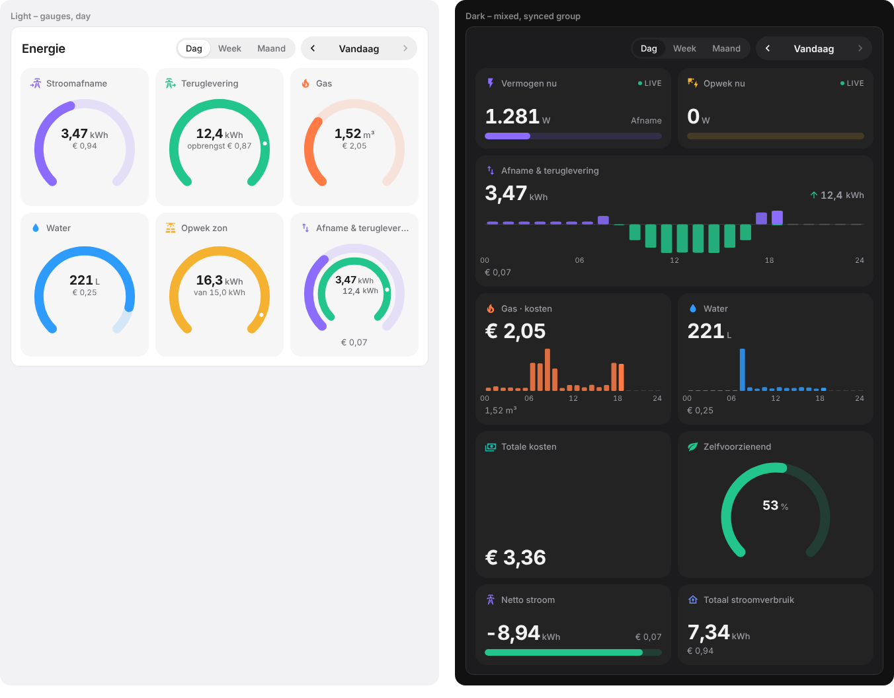
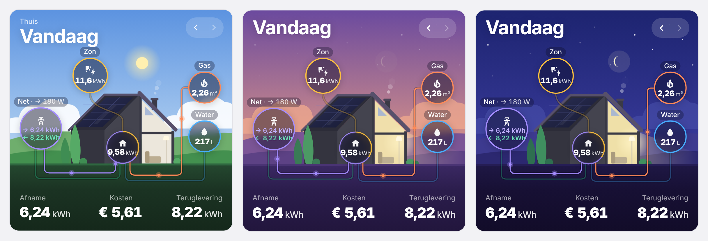

# Energy Display Card

Two Home Assistant dashboard cards in one file. The first is a tile card inspired by the **HomeWizard Energy Display**: clean tiles with circle gauges, bars, big values and hourly/daily charts for electricity import & export, solar, gas, water and costs. Navigate between days (default **today**), weeks and months.



- **Zero dependencies**, one JavaScript file (~105 KB, ~31 KB gzipped), no build step.
- Data from Home Assistant **long-term statistics** (the same data the Energy dashboard uses), so history is exact for any day, week or month. The running hour is topped up live from the sensor state.
- One statistics query per card per period, shared cache between cards, in-flight de-duplication, re-renders only the tiles that changed.
- **Visual editor** with auto-detection of HomeWizard P1 / Watermeter, SolarEdge and price helpers.
- Cards with the same `sync_group` move together: one card with navigation can drive every card on the page.
- Follows your HA theme (light/dark), Dutch and English UI.

## Installation

### HACS (recommended)

[](https://my.home-assistant.io/redirect/hacs_repository/?owner=riaan&repository=energy-display-card&category=plugin)

1. In Home Assistant open HACS → ⋮ (top right) → **Custom repositories**.
2. Add `https://github.com/riaan/energy-display-card` with category **Dashboard**, then **Add**.
3. Search for *Energy Display Card* in HACS → **Download**. HACS adds the dashboard resource for you.
4. Hard refresh the browser (clear the app cache in the mobile companion app).

### Manual
1. Download `energy-display-card.js` from the [latest release](https://github.com/riaan/energy-display-card/releases/latest) (or from `dist/`) and copy it to `/config/www/energy-display-card.js`.
2. Settings → Dashboards → ⋮ → **Resources** → Add resource
   URL `/local/energy-display-card.js?v=1`, type **JavaScript module**. (Enable *Advanced mode* in your user profile if you don't see Resources.)
3. Hard refresh the browser. Bump `?v=` after every update.

### Updating
HACS shows an update when a new release is published here. Download it from HACS, then hard refresh the browser (or clear the app cache on mobile) so the new file is loaded.

## Adding the card
Edit dashboard → **Add card** → search **Energy Display** (tiles) or **Energy House** (illustrated house). The card pre-fills itself with the entities it finds (HomeWizard, SolarEdge, price helpers). Use the editor to add, reorder, duplicate or remove tiles.

## Requirements
- Sensors must have long-term statistics (`state_class: total` or `total_increasing`). HomeWizard and SolarEdge sensors do this out of the box.
- Recorder enabled (default). History is as long as your statistics go back (kept forever by default).

## Configuration

```yaml
type: custom:energy-display-card
title: Energie
periods: [day, week, month]       # first one is the default; omit for day only
sync_group: default               # cards with the same group share the selected date
show_navigation: true             # hide on "follower" cards
columns: 0                        # 0 = auto-fit tiles, or fixed 1–6
compact: false
currency: EUR                     # defaults to your HA currency
sources:
  import:                         # one or more meters, summed (e.g. tariff 1 + 2)
    - sensor.p1_meter_energy_import_tariff_1
    - sensor.p1_meter_energy_import_tariff_2
  export:
    - sensor.p1_meter_energy_export_tariff_1
    - sensor.p1_meter_energy_export_tariff_2
  solar: sensor.solaredge_lifetime_energy   # Wh/kWh/MWh are converted automatically
  gas: sensor.p1_meter_total_gas
  water: sensor.watermeter_total_water
  power: sensor.p1_meter_power              # live W, negative = export
  solar_power: sensor.solaredge_current_power
prices:                                     # entity id (input_number / number / sensor) or a fixed number
  import: input_number.stroomprijs_per_kwh  # per kWh
  export: input_number.terugleverprijs_per_kwh
  gas: input_number.gasprijs_per_m3         # per m³
  water: input_number.waterprijs_per_m3     # per m³
  fixed_daily: 1.25                         # optional, added to total cost per day
tiles:
  - metric: import
    display: gauge
    goal: 8
  - metric: gas
    display: gauge
    show: cost
  - metric: import_export
    display: chart
    span: 2
```

> Use **either** the total meter (`sensor.p1_meter_energy_import`) **or** the tariff meters — not both, or usage is counted twice.

### Metrics (`metric`)
| metric | shows |
|---|---|
| `import` | electricity taken from the grid (kWh) |
| `export` | electricity returned to the grid (kWh) |
| `net` | import − export (negative = net producer) |
| `import_export` | import and export together (dual ring / up-down chart) |
| `solar` | solar production |
| `self_consumption` | solar used directly in the house (solar − export) |
| `usage_total` | total house usage (import + solar − export) |
| `self_sufficiency` | % of usage covered by own solar |
| `gas` | gas (m³) |
| `water` | water (shown in litres; `unit: m³` to change) |
| `power` | live grid power (W) |
| `solar_power` | live solar power (W) |
| `cost_total` | import + gas + water − export revenue + fixed costs |

### Tile options
| option | default | description |
|---|---|---|
| `display` | `gauge` | `gauge`, `bar`, `value`, `chart` (per hour on day view, per day on week/month) |
| `show` | `usage` | `cost` shows money instead of usage (for metrics with a price) |
| `goal` | per metric | gauge/bar maximum **per day**, in the unit shown (L for water). Multiplied by the number of days in week/month view (`goal_per_day: false` to disable). For live tiles it is the maximum in W. |
| `secondary` | `auto` | second line: `auto`, `cost`, `goal`, `none` |
| `span` | 1 | tile width in grid columns |
| `name`, `icon`, `color` | | override label, MDI icon, hex colour (`color_export` for the export side) |
| `entity` | | use another entity than the card-level source |
| `unit` | | `L`/`m³` for water, `Wh` for energy, `kW` for power |
| `decimals` | auto | number of decimals |
| `tap_action` | more-info | `none` to disable the popup |

### Prices
- `input_number` helper with a fixed price: the current value is used for the whole period.
- A **dynamic price sensor** (EnergyZero, Nord Pool, Tibber… with `state_class: measurement`): the card uses the hourly mean price from statistics, so every hour is costed at its own price.
- A plain number works too (`import: 0.27`).

### Synchronising several cards
Put `periods` and `show_navigation: true` on one card, and `show_navigation: false` on the others with the same `sync_group`. All of them follow the selected date.

## Card 2 — Energy House (`custom:energy-house-card`)

An illustrated house in the HomeWizard app style, combined with the clear nodes and animated flow lines of Home Assistant's energy distribution card.



- **Sky follows the sun** (uses `sun.sun`, or calculates the sun position from your HA location): day, golden hour, dusk and a starry night with a moon. The room lights up when it gets dark.
- **Nodes** for solar, grid (→ import / ← export), gas and water, plus a home node whose ring shows how much came from your own solar (orange) versus the grid (purple).
- **Animated flows**: solar comes in from the roof, the grid cable and gas/water pipes run underground into the meter. For today the dots show what is happening *now* (live power sensors, or the running hour). Faster dots mean more power. For past days they show the totals of that day.
- The chimney smokes while gas is being used.
- The bottom row (like the HomeWizard app) shows up to 4 items, by default import, cost and export.
- Swipe left/right on the scene or use ‹ › to change day. Shares `sync_group` with the tile card.
- Anything without a source, or switched off, disappears completely (node, line, roof panel, chimney).

```yaml
type: custom:energy-house-card
title: Thuis                      # optional small subtitle above the date
periods: [day, week, month]       # optional; a pill cycles through them
sources:                          # same as the tile card
  import: [sensor.p1_meter_energy_import_tariff_1, sensor.p1_meter_energy_import_tariff_2]
  export: [sensor.p1_meter_energy_export_tariff_1, sensor.p1_meter_energy_export_tariff_2]
  solar: sensor.solaredge_lifetime_energy
  gas: sensor.p1_meter_total_gas
  water: sensor.watermeter_total_water
  power: sensor.p1_meter_power              # live, negative = exporting
  solar_power: sensor.solaredge_current_power
prices:
  import: input_number.stroomprijs_per_kwh
  export: input_number.terugleverprijs_per_kwh
  gas: input_number.gasprijs_per_m3
  water: input_number.waterprijs_per_m3
footer: [import, cost_total, export]        # any non-live metric from the table above, max 4
show_water: false                           # hide parts: show_solar / show_grid / show_gas / show_water / show_home
show_live: true                             # live W/kW next to the Zon/Net labels
scene: auto                                 # auto | day | golden | dusk | night
max_power: 5000                             # W at which the flow dots run at full speed
invert_power: false                         # if your grid power sensor is positive when exporting
```

## Troubleshooting
- **"No statistics"** in a tile: the entity has no long-term statistics (missing `state_class`) or is misspelled. Check Developer tools → Statistics.
- **Today seems one hour behind**: statistics are compiled at the end of every hour; the card adds the live difference since then, so the total is current, but the running hour bar fills in as the sensor updates.
- **Card not found** after install: hard refresh / clear the companion app cache.

## Development
`npm install && npm run lint` checks the code. See [CHANGELOG.md](CHANGELOG.md) for release notes.

MIT licensed.
